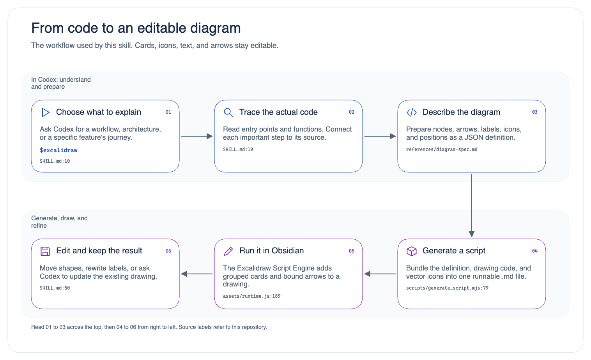

# Excalidraw Skill

**Ask Codex to turn a project's code into an editable workflow diagram in Obsidian.**

This skill grew out of [Zsolt Viczián's `ea-script-template`](https://github.com/zsviczian/ea-script-template)
and builds on his [Obsidian Excalidraw plugin](https://github.com/zsviczian/obsidian-excalidraw-plugin).
See [Credits and original work](#credits-and-original-work) for the upstream projects.

For example, ask “What happens when a user signs in?” Codex reads the relevant
code, identifies the steps, and prepares an Excalidraw drawing with labeled cards,
icons, and connecting arrows. You can then move shapes and edit the text yourself.

## See what it creates

This example explains how the skill itself works. It was generated with the
bundled script generator, run in Obsidian, and exported from the resulting drawing.
Click the image to see it at full size.

[](docs/workflow-preview.png)

Try the [editable Obsidian drawing](docs/example-workflow.excalidraw.md), or
[recreate this example](#try-the-example-without-analyzing-a-project).
To download the drawing from GitHub, open its link and choose **Download raw file**.
Copy the file into your Obsidian vault and open it there.

## How does this relate to Obsidian?

Three pieces work together:

| Piece | What it does |
| --- | --- |
| **Codex + this skill** | Reads your project and decides what the diagram should show. |
| **Obsidian** | Stores your notes and drawings in a folder called a **vault**. |
| **Excalidraw plugin for Obsidian** | Runs the generated drawing script and lets you edit the result on a canvas. |

The skill includes instructions, a script generator, and editable vector icons.
You can use it across projects without cloning the original `ea-script-template`
repository. No Mermaid knowledge or JavaScript experience is needed for normal use.

## Before you start

You will need:

- **Codex** with access to the project folder you want to diagram.
- **[Git](https://git-scm.com/downloads)** to use the clone commands below.
  Check with `git --version`.
- **Node.js 22.13 or newer** to generate scripts. Check with `node --version`;
  [download Node.js](https://nodejs.org/en/download) if needed.
- **[Obsidian](https://obsidian.md/download)** and the **Excalidraw community plugin
  version 2.27.0 or newer** to run the script and edit the drawing.

The generator needs no `npm install` or build step. The Obsidian CLI is optional;
you can run scripts through Obsidian's command palette.

## 1. Install the skill

Open **Terminal** on macOS/Linux or **PowerShell** on Windows. This downloads the
skill into your personal skills folder, making it available across projects.

**macOS / Linux**

```sh
mkdir -p "$HOME/.agents/skills"
git clone https://github.com/shuxiangzhang/excalidraw-skill.git "$HOME/.agents/skills/excalidraw"
```

**Windows PowerShell**

```powershell
New-Item -ItemType Directory -Force "$HOME/.agents/skills" | Out-Null
git clone https://github.com/shuxiangzhang/excalidraw-skill.git "$HOME/.agents/skills/excalidraw"
```

In Codex, type `$excalidraw` to select the skill. If it does not appear, restart
Codex and try again. These locations follow the
[official OpenAI documentation for local skills](https://learn.chatgpt.com/docs/build-skills).

Already installed it? Use [Update the skill](#update-the-skill) below. Keep an
existing installation in `~/.codex/skills/excalidraw` there; avoid installing a
second copy in another skills folder.

## 2. Prepare Obsidian once

1. Open your vault in Obsidian.
2. Go to **Settings → Community plugins → Browse**, search for **Excalidraw**,
   and install and enable it. Enable community plugins if prompted.
3. Go to **Settings → Excalidraw**, find **Script Engine**, and set
   **Excalidraw Automate script folder** to a subfolder such as
   `Excalidraw/Scripts`. Create that folder inside your vault if necessary.
   Use a subfolder rather than the vault root.

The plugin's [Script Engine guide](https://github.com/zsviczian/obsidian-excalidraw-plugin/blob/master/docs/ExcalidrawScriptsEngine.md)
explains how scripts are discovered and run.

## 3. Create your first project diagram

Open the project you want to understand in Codex. Keep your Obsidian vault open,
then send a prompt like this, replacing the vault name:

```text
$excalidraw Analyze this codebase and draw its main workflow with icons.
Keep it to about 6–8 steps and include source-file references.
Save it as a new editable drawing in my Obsidian vault "My Notes".
Also give me the reusable drawing script and a PNG preview.
```

Codex reads the project, creates a diagram definition, and generates a drawing
script. With access to a running Obsidian instance and its CLI, it can run the
script and export the preview. Otherwise, it gives you the script to run manually.

**To run a generated script manually:**

1. Copy the generated `.md` script into the scripts folder you configured in
   step 2, for example `My Notes/Excalidraw/Scripts/my-workflow.md`.
2. In Obsidian, open the command palette with **Cmd+P** on macOS or **Ctrl+P**
   on Windows/Linux. Search for Excalidraw's command to create a new drawing.
3. Keep that drawing active, open the command palette again, search for the
   script's filename, such as `my-workflow`, and select its Excalidraw script command.
4. The diagram appears on the canvas. Move a card or edit a label to try it out.
   Press **Cmd+S** on macOS or **Ctrl+S** on Windows/Linux to save the drawing.

The files have different jobs:

| File | What to do with it |
| --- | --- |
| `my-workflow.md` | Executable JavaScript saved as Markdown. Put it in the Script Engine folder and run it from a drawing. |
| `My Workflow.excalidraw.md` | The editable drawing. Open this in Obsidian to work on the canvas. |
| `my-workflow.png` | An image preview for sharing or documentation. |

Each run of a generated script adds another copy below existing content. To
revise a drawing, edit its shapes or ask Codex to update the existing drawing.
Diagrams are snapshots of the code at the time they are created.

## More prompts to try

**Understand one feature**

```text
$excalidraw Trace what happens when a user signs in, from the UI to the server
and back. Draw the flow with icons and label each step with its source file.
```

**Draw a process you describe**

```text
$excalidraw Draw this release process in Obsidian:
prepare changes → run tests → build → publish → verify.
Use an icon for each step.
```

**Update an existing diagram**

```text
$excalidraw Update "Drawings/Project Workflow.excalidraw.md" in my vault.
Add the new validation step and its connections. Preserve my existing edits.
```

**Use Chinese**

```text
$excalidraw 分析当前项目的代码，生成带图标的可编辑工作流程图。
请用中文标注，附上关键步骤的源文件路径，并保存到我的 Obsidian vault。
```

## Try the example without analyzing a project

You can reproduce the screenshot using its
[diagram definition](docs/example-workflow.json). Run these commands in Terminal
or PowerShell after installing the skill:

```sh
cd "$HOME/.agents/skills/excalidraw"
mkdir output
node scripts/generate_script.mjs docs/example-workflow.json output/example-workflow.md
```

If `output` already exists, skip `mkdir output`. If you installed into another
folder, use that folder in the `cd` command.

Copy `output/example-workflow.md` into your Obsidian Script Engine folder, then
follow the manual steps above. You should see six numbered cards with icons and
five arrows, matching the preview.

To customize it, copy `docs/example-workflow.json`, change the node titles,
descriptions, and relationships, then pass your copy to the generator. See the
[diagram format guide](references/diagram-spec.md) for all fields and icon names.
The generator draws the definition you supply; Codex performs the code analysis.

## Troubleshooting

| Problem | What to check |
| --- | --- |
| `$excalidraw` is missing | Confirm `SKILL.md` is directly inside the installed `excalidraw` folder, then restart Codex. |
| Git says the destination already exists | Update the existing checkout instead of cloning over it. |
| `git` or `node` is not found | Install the missing tool, then reopen your terminal and Codex. |
| The script does not appear in Obsidian | Check that Excalidraw is enabled, the `.md` file is in the configured scripts folder, and an Excalidraw drawing is active. |
| The script opens as text | Run its command from an active Excalidraw drawing. Opening the script file as a note does not execute it. |
| The script asks for a newer plugin | Update Excalidraw to at least 2.27.0. |
| The generator reports `EEXIST` | Choose a new output filename, or add `--force` to intentionally replace that generated script. |
| Codex cannot connect to Obsidian | Use the manual script steps above; the Obsidian CLI is optional. |

## Update the skill

For the installation shown above, run this in Terminal or PowerShell:

```sh
git -C "$HOME/.agents/skills/excalidraw" pull --ff-only
```

For an existing installation in the older location:

```sh
git -C "${CODEX_HOME:-$HOME/.codex}/skills/excalidraw" pull --ff-only
```

The second command uses macOS/Linux shell syntax. On Windows, use
`git -C "$HOME/.codex/skills/excalidraw" pull --ff-only`, or your custom Codex home
path. If you have local changes that prevent an update, keep them and resolve
the changes before pulling again.

## Credits and original work

Thank you to **Zsolt Viczián ([@zsviczian](https://github.com/zsviczian))** and
the upstream contributors whose work made this skill possible:

- **[ea-script-template](https://github.com/zsviczian/ea-script-template)** —
  the original project that this skill grew out of. Its ExcalidrawAutomate
  authoring workflow, examples, and guidance informed this skill's scripting
  approach. [Upstream license: AGPL-3.0](https://github.com/zsviczian/ea-script-template/blob/main/LICENSE).
- **[Obsidian Excalidraw](https://github.com/zsviczian/obsidian-excalidraw-plugin)**,
  also by Zsolt Viczián — provides the Obsidian integration, Script Engine,
  ExcalidrawAutomate API, and native CLI that this skill uses to create and edit
  drawings. [Upstream license: AGPL-3.0](https://github.com/zsviczian/obsidian-excalidraw-plugin/blob/master/LICENSE).
- **[Excalidraw](https://github.com/excalidraw/excalidraw)** — the drawing editor
  and editable scene format, created and maintained by the Excalidraw team and
  contributors. [Upstream license: MIT](https://github.com/excalidraw/excalidraw/blob/master/LICENSE).

This repository packages that workflow as a reusable Codex skill, with a
standalone diagram generator, drawing resources, and beginner documentation.
The upstream license links describe the respective upstream projects.

## For contributors

Run the existing regression test with Node's built-in test runner:

```sh
node --test tests/generator.test.mjs
```

| Path | Purpose |
| --- | --- |
| [SKILL.md](SKILL.md) | Instructions Codex follows when using the skill |
| [scripts/generate_script.mjs](scripts/generate_script.mjs) | Standalone script generator |
| [assets/runtime.js](assets/runtime.js) | Drawing and text-layout code |
| [assets/icons.mjs](assets/icons.mjs) | Editable vector icons |
| [references/diagram-spec.md](references/diagram-spec.md) | Input format and layout options |
| [references/ea-runtime.md](references/ea-runtime.md) | Script Engine API guidance |
| [references/obsidian-cli.md](references/obsidian-cli.md) | Optional CLI integration |
